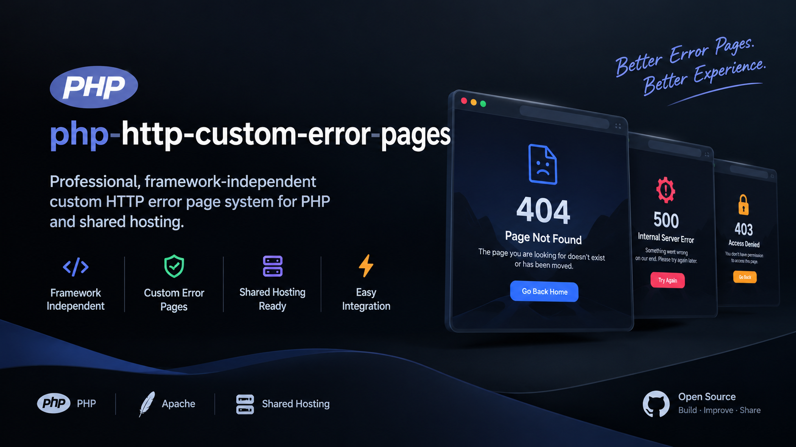

<div align="center">



# PHP HTTP Custom Error Pages

**Clean, responsive, framework-independent HTTP error pages for PHP and Apache.**

[](https://www.php.net/)
[](https://httpd.apache.org/)
[](https://developer.mozilla.org/en-US/docs/Web/CSS)

[Features](#features) · [HTTP Status Codes](#default-http-status-codes) · [Installation](#installation) · [Customization](#customization) · [License](#license)

</div>

---

## Overview

**PHP HTTP Custom Error Pages** is a lightweight error-page system for PHP websites running on Apache.

It replaces generic server error responses with consistent, responsive pages while keeping the original requested URL in the browser. The project uses native PHP, custom CSS, locally stored fonts, and local SVG icons—without requiring a CSS or JavaScript framework.

The included templates cover common HTTP errors, and the architecture allows additional status-code templates to be added when needed.

## Features

- **Ready-to-use error pages** for HTTP 403, 404, 500, and 503.
- **Apache integration** through the `ErrorDocument` directive.
- **Framework-independent architecture** built with PHP.
- **Responsive layout** using CSS and Flexbox.
- **No CSS or JavaScript framework dependencies.**
- **Locally stored fonts and SVG icons** for self-contained assets.
- **Automatic asset versioning** to help browsers refresh updated resources.
- **Automatic site-name detection** based on the request hostname.
- **Client IP detection and display** in the error-page interface.
- **Reusable shared layout** with separate templates for each error.
- **Escaped dynamic values** when rendered in HTML.

## Default HTTP Status Codes

| Code | Status | Typical meaning |
|---|---|---|
| `403` | Forbidden | Access to the requested resource is denied. |
| `404` | Not Found | The requested resource could not be found. |
| `500` | Internal Server Error | The server encountered an unexpected condition. |
| `503` | Service Unavailable | The service is temporarily unavailable. |

The routing system is designed to support status codes in the `400–599` range when corresponding templates and server configuration are provided. Only the four templates listed above are included by default.

## Requirements

- PHP **7.4 or later**.
- Apache with support for the `ErrorDocument` directive.
- `mod_rewrite` enabled if using the supplied rewrite rules.
- Permission for the required directives in `.htaccess`, or equivalent configuration in the main Apache configuration.

## Installation

### 1. Upload the project

Place the project inside your website's document root. For example:

```text
/public_html/errors/
```

The `/errors/` path is an example. Adjust the configuration if you choose a different installation directory.

### 2. Configure Apache

Add the following rules to the `.htaccess` file in your website's document root:

```apache
RewriteEngine On

RewriteCond %{REQUEST_URI} ^/errors/
RewriteCond %{REQUEST_URI} !^/errors/index\.php$
RewriteCond %{REQUEST_URI} !^/errors/assets/
RewriteRule ^ - [F,L]

ErrorDocument 403 /errors/index.php
ErrorDocument 404 /errors/index.php
ErrorDocument 500 /errors/index.php
ErrorDocument 503 /errors/index.php
```

**Important:** This example assumes the project is installed at `/errors/`. Update the paths if your installation directory differs. Apache must permit the directives used by this configuration.

If `.htaccess` is disabled on your server, configure the equivalent rules in the main Apache configuration instead.

### 3. Understand the request flow

The `/errors/` directory is intended for internal use by the error-handling system. The supplied rewrite rules restrict direct browser access to internal files while allowing the assets and designated entry point.

For example, direct access to this template should be denied:

```text
https://example.com/errors/template-parts/404/index.php
```

Apache can still internally invoke `/errors/index.php` through `ErrorDocument`. The browser remains on the originally requested URL; the error handler does not need to redirect the visitor to the error directory.

### 4. Test the installation

Open a URL that does not exist on your website:

```text
https://example.com/this-page-does-not-exist
```

If Apache is configured correctly, the custom 404 page should appear at that URL.

Test the other status codes in an appropriate staging environment or through controlled server/application scenarios. Avoid deliberately triggering server errors on a live production site.

## Project Structure

```text
php-http-custom-error-pages/
├── assets/
│   ├── component/
│   │   └── global.js
│   ├── fonts/
│   │   ├── Inter/
│   │   ├── JetBrainsMono/
│   │   └── Manrope/
│   ├── images/
│   │   └── project-banner.png
│   └── styles/
│       └── global.css
├── includes/
├── template-parts/
├── .htaccess
├── footer.php
├── header.php
├── index.php
├── LICENSE
├── README.md
└── THIRD-PARTY-NOTICES.md
```

## Customization

### Add another error page

The project includes templates for `403`, `404`, `500`, and `503`. To add another status code, such as `429`:

1. Create the corresponding template directory under `template-parts/`, following the existing template structure.
2. Add the template content and integrate it with the shared layout and routing logic.
3. Register the new status code in the routing logic where required.
4. Add an appropriate Apache directive, for example:

   ```apache
   ErrorDocument 429 /errors/index.php
   ```

5. Test the new template and verify that the intended HTTP status code is preserved.

Follow the conventions of the existing PHP files when extending the project.

### Customize the appearance

Edit the shared stylesheet:

```text
assets/styles/global.css
```

The local font files are stored in `assets/fonts/`, and the SVG icon helpers are located in `includes/icons.php`.

### Shared layout and helpers

- `includes/index.php` — shared layout.
- `includes/icons.php` — SVG icon helpers.
- `assets/styles/global.css` — global styling.
- `assets/component/global.js` — JavaScript component file.
- `template-parts/` — individual HTTP error templates.

Refer to the existing implementation before changing routing, escaping, or asset-versioning behavior.

## Security and Deployment Notes

- Keep internal templates and helper files inaccessible to direct browser requests.
- Verify that Apache's `ErrorDocument` and rewrite rules match your installation path.
- Review client IP handling carefully when your website is behind a reverse proxy or CDN. Forwarded IP headers should only be trusted when supplied by a trusted proxy.
- Avoid exposing sensitive implementation details, credentials, stack traces, or private server information in public-facing error messages.
- Test configuration changes in staging before deploying them to production.

## Third-Party Notices

This project includes locally stored font assets and other resources. Refer to [`THIRD-PARTY-NOTICES.md`](THIRD-PARTY-NOTICES.md) for applicable third-party attribution and licensing information.

## License

This project is distributed under its own **PHP HTTP Custom Error Pages License**, available in [`LICENSE`](LICENSE).

The license permits use, study, modification, and incorporation into personal, educational, development, and commercial projects, subject to its terms. Standalone resale, commercial redistribution, sublicensing, or distribution of modified versions as an independent or competing product requires prior written permission.

Retain the original copyright and attribution notices. Third-party resources remain subject to their respective licenses.

For the complete terms, consult the `LICENSE` file. This summary does not replace the license itself.

## Author

## Author

**Abolfazl Shoja** | **(ByteNest Group)**

Copyright © 2026 Abolfazl Shoja — ByteNest Group.

Repository: [php-http-custom-error-pages](https://github.com/abolfazlshojadev/php-http-custom-error-pages)

Copyright © 2026 Abolfazl Shoja — ByteNest Group.
